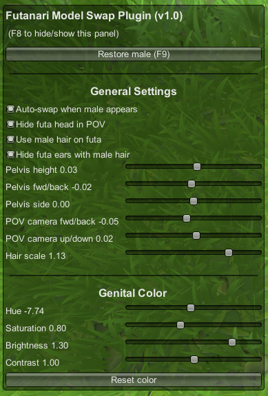

# FMEN - Model Swap Plugin

A [BepInEx](https://github.com/BepInEx/BepInEx) plugin for **["Flee, My Elven Ninja!"](https://store.steampowered.com/app/3830690/Flee_My_Elven_Ninja__3D/)** that replaces the male actor's body in the game's 3D scenes with a clone of the default female character's body, making the protagonist seem like a futanari. The clone is posed live from the male actor's animation, so the game's scripted scenes keep working as normal.

Everything happens at runtime. No game files are modified, and uninstalling involves just  removing the plugin DLL that restores the game completely.

> **Adults only (18+).** Requires a legitimate copy of **["Flee, My Elven Ninja!"](https://store.steampowered.com/app/3830690/Flee_My_Elven_Ninja__3D/)**. This project is not affiliated with or endorsed by the game's developers, and it contains no game assets. And due to Github's rules, I can't show any demo screenshots of the mod working other than the in-game Settings UI.

>**AI Disclosure:** This mod was coded entirely with Claude AI (Sonnet 5.5) while the design and decision for what feature to add is entirely by me.

---

## Table of contents

- [Features](##Features)
- [What the plugin does and does not do](#What-the-plugin-does-and-does-not-do)
- [How to use](#How-to-use)
- [Modding requirements and install (for users)](#Modding-requirements-and-install-(for-users))
- [Build requirements (for developers)](#Build-requirements-(for-developers))
- [Support me](#Support-me)
- [License](#License)

---

## Features

- **Automatic swap:** when the male actor appears in a scene, the swap happens by itself. It can also be triggered or undone by hand with **F9**. Currently, the chosen female model is the default one of the game's heroine Lizet.
- **Animation-driven:** the female clone copies the male actor's bone rotations by bone name, so any scripted animation drives her without changes to the scene.
- **Selective hiding:** only the male _body_ submesh is hidden. The male model's genitalia stays as is until the scene ends.
- **In-game settings panel** (toggle with **F8**) with live sliders for:
    - Pelvis height, forward/back and side offsets, to line up the different body proportions
    - POV camera forward/back and up/down offsets
    - Hiding the futa's head while the POV camera is active
    - Color adjustment (hue, saturation, brightness, contrast) for the male's genitalia mesh
- **Keeping the male hair:** an optional toggle that attaches the male hair to the futa's skeleton for the sake of immersion, with a hair scale slider and an optional switch to hide the futa's ears, to fix clipping.
- **Saved settings:** all options are stored automatically in a BepInEx config file and restored on the next launch. Config file location and more details below.
- **Fully reversible:** press F9 at any time to bring the original male model back.

---

## What the plugin does and does not do

**It does:**

- Work only while the game is running and in NSFW scenes, and only on objects in memory.
- Work on private copies of materials, so the game's own materials are never changed.
- Let you change the object names it looks for (male root, female root, hair, ear) in the config file, in case a scene or game update uses different names.
- Works in scenes during the game story and not just the Gallery scenes. Though there are a few mismatch so expect some bug fixes later on as I unlock more scenes myself.

**It does not:**

- Have scrotum as the original male doesn't either so the replaced futanari is not full-packaged.
- Constantly update the futa's face expressions. Because the futa model is the clone of the female model, the facial expressions will only stay at the moment of swapping.
- Include, extract or redistribute any game assets or models.
- Modify game files or save files.
- Support IL2CPP builds of Unity games (the plugin targets Mono builds with BepInEx 5).
- Currently offer a choice between several female bodies. It clones the one female root named in the config.
- Almost perfect fit. The two bodies have different proportions, so some clipping or contact drift can happen. The offset sliders exist to reduce it.
- Come with official support for other games or other game versions. It was tested with Version v0504 on Windows.

---

## How to use

1. Start the game and open a scene that contains the male actor. The swap happens automatically after a moment. If it doesn't, press **F9**.
2. Use the on-screen panel to adjust the result live.
3. Your settings are saved about a second after you stop changing them.

**Hotkeys**

|Key|Action|
|---|---|
|F9|Swap to the female clone / restore the male model|
|F8|Show or hide the settings panel|

**Settings Panel**



**Tips**

- If there is a gap between the clone's body and the male's separate submesh, try the **Pelvis fwd/back** slider first
- If the futa's scalp shows through the male hair, raise **Hair scale** slowly (around 1.13 works well).
- The two POV camera sliders are relative to the camera's own view direction.

**Config file**

Settings are stored in `BepInEx/config/com.github.zaeno-eileena.fmen.modelswapplugin.cfg`, created on first launch. You can edit it with the game closed.

| Section       | Setting                | Default                      | Meaning                                                                    |
| ------------- | ---------------------- | ---------------------------- | -------------------------------------------------------------------------- |
| Setup         | `MaleRootName`         | `male_v02`                   | Name of the male actor's root object                                       |
| Setup         | `FemaleRootName`       | `Lizet_02`                   | Name of the female root object that gets cloned                            |
| Setup         | `MaleBodyMaterialSlot` | `0`                          | Material slot of the male body (the other slot is left visible)            |
| Setup         | `KeepScriptHints`      | `Bone,Spring,Jiggle,Physics` | Name parts of scripts kept on the clone (for example physics)              |
| Setup         | `FemaleHairObjectName` | `hair`                       | Name of the clone's hair object                                            |
| Setup         | `FemaleEarObjectName`  | `ear`                        | Name of the clone's ear object                                             |
| General       | `AutoSwap`             | `true`                       | Swap automatically when the male actor appears                             |
| General       | `HideCloneHeadInPOV`   | `true`                       | Hide the clone's head while the POV camera is active                       |
| General       | `PelvisHeightOffset`   | `0`                          | Clone pelvis up (+) / down (-), range -0.5 to 0.5                          |
| General       | `PelvisForwardOffset`  | `0`                          | Clone pelvis forward (+) / back (-), range -0.5 to 0.5                     |
| General       | `PelvisSideOffset`     | `0`                          | Clone pelvis right (+) / left (-), range -0.5 to 0.5                       |
| General       | `PovCameraOffset`      | `0`                          | POV camera forward (+) / back (-), range -0.5 to 0.5                       |
| General       | `PovCameraUpOffset`    | `0`                          | POV camera up (+) / down (-), range -0.5 to 0.5                            |
| General       | `HelperWeight`         | `0`                          | How much the thigh helper bones follow the thigh, range 0 to 1             |
| General       | `UseMaleHair`          | `false`                      | Use the male hair on the clone instead of her own                          |
| General       | `HideEarsWithMaleHair` | `false`                      | Hide the clone's ears while the male hair is used                          |
| General       | `MaleHairScale`        | `1`                          | Scales the male hair around the clone's head joint, range 0.9 to 1.2       |
| Genital color | `Hue`                  | `0`                          | Hue shift in degrees, range -180 to 180                                    |
| Genital color | `Saturation`           | `1`                          | Saturation multiplier, range 0 to 2                                        |
| Genital color | `Brightness`           | `1`                          | Brightness multiplier, range 0.5 to 1.5                                    |
| Genital color | `Contrast`             | `1`                          | Contrast multiplier, range 0.5 to 1.5                                      |
| Genital color | `TextureProperty`      | _(empty)_                    | Shader texture property to adjust. Empty means the material's main texture |

---

## Modding requirements and install (for users)

**Requirements**

- Windows, 64-bit
- **["Flee, My Elven Ninja!"](https://store.steampowered.com/app/3830690/Flee_My_Elven_Ninja__3D/)**, a Unity **Mono** build (it has a `ELFxNINJA_Data/Managed` folder), tested on Unity 2022.3.62.7762112
- [BepInEx 5.4.23.5](https://github.com/BepInEx/BepInEx/releases), the `BepInEx_win_x64` build. Do not use BepInEx 6.

**Step 1: install BepInEx (skip if you already have it)**

1. Download `BepInEx_win_x64_5.4.x.zip` from the BepInEx releases page.
2. Extract the contents into the game folder, **next to the game's `.exe`**. You should see `winhttp.dll`, `doorstop_config.ini` and a `BepInEx` folder beside the exe, not inside a subfolder.
3. Run the game once and close it. BepInEx creates its `config` and `plugins` folders.

**Step 2: install the plugin**

1. Download `ELFxNINJA_ModelSwapMod.dll` from the [Releases](https://github.com/Zaeno-Eileena/FMEN-ModelSwapPlugin/releases/tag/1.0.0) page.
2. _(Optional)_ Check the file against the SHA-256 hash in the release notes (see below).
3. Copy `ELFxNINJA_ModelSwapMod.dll` into `Flee_My_Elven_Ninja_v0504/BepInEx/plugins`.
4. Launch the game.

**Verify the download (optional)**

Open PowerShell in the folder with the DLL and run:

```powershell
Get-FileHash .\ELFxNINJA_ModelSwapMod.dll -Algorithm SHA256
```

or, in Command Prompt:

```
certutil -hashfile ELFxNINJA_ModelSwapMod.dll SHA256
```

The result should match the SHA-256 listed in the release notes for that version.

**Linux / Steam Deck (Proton)**

Add this launch option in Steam: `WINEDLLOVERRIDES="winhttp=n,b" %command%`

**Uninstall**

Delete `ELFxNINJA_ModelSwapMod.dll` from `BepInEx/plugins`. Optionally delete `BepInEx/config/com.github.zaeno-eileena.fmen.modelswapplugin.cfg` to remove the saved settings.

**Troubleshooting**

- Nothing happens: open `BepInEx/LogOutput.log` and check that the plugin is listed. If there is no log at all, BepInEx isn't installed correctly (wrong folder, wrong 32/64-bit build, or antivirus blocking `winhttp.dll`).
- The swap doesn't trigger: check the log for "root not found" messages. The names in the config file may not match your game version.
- Something looks wrong after a scene change: press F9 twice to restore and swap again.

---

## Build requirements (for developers)

If you would rather build the DLL yourself than download it, you need:

- **Visual Studio 2022** (Community is fine) with the **.NET desktop development** workload
- **.NET Framework 4.7.2** targeting pack (included with that workload)
-  **["Flee, My Elven Ninja!"](https://store.steampowered.com/app/3830690/Flee_My_Elven_Ninja__3D/)** installed, with **BepInEx 5** installed and run once, because the references come from the game folder

**Required references**

|File|Where to find it|
|---|---|
|`BepInEx.dll`|`<game folder>/BepInEx/core`|
|`UnityEngine.dll`|`<game folder>/<GameName>_Data/Managed`|
|`UnityEngine.CoreModule.dll`|`<game folder>/<GameName>_Data/Managed`|
|`UnityEngine.AnimationModule.dll`|`<game folder>/<GameName>_Data/Managed`|
|`UnityEngine.PhysicsModule.dll`|`<game folder>/<GameName>_Data/Managed`|
|`UnityEngine.IMGUIModule.dll`|`<game folder>/<GameName>_Data/Managed`|

**Build steps**

1. Clone or download this repository.
2. Open the `.sln` file in Visual Studio.
3. In Solution Explorer, expand **References**. If any entry shows a warning icon, remove it, then right-click **References > Add Reference... > Browse...** and add the files from the table above from your own game folder.
4. Choose **Build > Build Solution** (Ctrl+Shift+B).
5. Your DLL is in `[PROJECT FOLDER]\bin\Debug\ELFxNINJA_ModelSwapMod.dll`. Copy that one file into `<game folder>/BepInEx/plugins`.

The game and BepInEx DLLs are never included in this repository. You reference your own copies.

**A build from source will not have the same hash as the release file**, because .NET builds are not bit-for-bit identical from machine to machine. That is expected. The hash only checks that the file you downloaded is the one that was uploaded.

**Source layout**

|File|What it contains|
|---|---|
|`ModelSwapPlugin.cs`|Plugin entry point, `Update` loop, auto-swap polling|
|`Settings.cs`|All saved settings and the delayed config save|
|`Swap.cs`|Building the female clone and restoring the male model|
|`PoseDriver.cs`|Per-frame pose copying, pelvis offsets, thigh helper bones, head hiding|
|`PovCamera.cs`|POV camera detection and camera offset|
|`Hair.cs`|Attaching the male hair to the clone's skeleton|
|`GenitalColor.cs`|Texture color adjustment|
|`UI.cs`|The in-game panel and hotkeys|

The plugin class is a C# `partial class` split across these files, so a change to one feature stays in one file.

---

## Support me

If you enjoy this project and want to support its development, you can do so here at my *alternate account*:

<a href="https://www.buymeacoffee.com/nhk512" target="_blank"></a>

It is completely optional. The plugin is, and will stay, free.

---

## License

This project is licensed under the **GNU General Public License v3.0**. See the [LICENSE](LICENSE.txt) file for the full text.

BepInEx, Unity and  **["Flee, My Elven Ninja!"](https://store.steampowered.com/app/3830690/Flee_My_Elven_Ninja__3D/)** are separate works with their own licenses and are not distributed in this repository.

Copyright (C) [2026] [Zaeno-Eileena]
